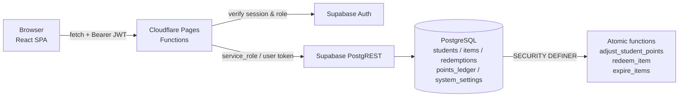

<p align="center">
  <b>English</b> | <a href="./README.md">简体中文</a>
</p>

<div align="center">
  
</div>

<h1 align="center">Points Store · Student Reward Platform</h1>

<p align="center">
  Teachers award points for good performance; students redeem them for prizes and study materials.<br/>
  A self-hosted campus points store — deploy in 5 minutes, no server to maintain.
</p>

<p align="center">
  <a href="#quick-start"></a>
  <a href="./LICENSE"></a>
  
  
  
  
  
</p>

<p align="center">
  <sub>Student / Teacher / Admin consoles · Atomic points &amp; stock · Row Level Security · Chinese-only UI</sub>
</p>

---

## Table of Contents

- [Introduction](#introduction)
- [Features](#features)
- [Quick Start](#quick-start)
- [Usage Examples](#usage-examples)
- [Configuration](#configuration)
- [Architecture](#architecture)
  - [Directory Structure](#directory-structure)
  - [Data Flow](#data-flow)
  - [Data Consistency](#data-consistency)
  - [Security Model](#security-model)
- [API Reference](#api-reference)
- [Deploy to Cloudflare Pages](#deploy-to-cloudflare-pages)
- [FAQ](#faq)
- [Roadmap](#roadmap)
- [Changelog](#changelog)
- [Contributing](#contributing)
- [License](#license)
- [Contributors](#contributors)
- [Acknowledgements](#acknowledgements)

---

## Introduction

Points-based rewards in schools usually live on paper: points in a notebook, redemptions confirmed verbally, statistics tallied by hand.
This project turns that into a deployable web app — **teachers award, students redeem, admins manage stock** — with every step recorded and every number traceable.

- **Problem it solves**: moves the "classroom performance → points → prize redemption" loop online, eliminating lost records, wrong entries and disputes at the redemption desk.
- **Who uses it**: one system, three roles — students (redeem), teachers (award / hand out), admins (items and accounts).
- **How it is deployed**: frontend and API on Cloudflare Pages, data and auth on Supabase — **no server to maintain**.

> All UI copy is in Chinese; the database is PostgreSQL; the deployment target is Cloudflare (Pages + Pages Functions).

---

## Features

### 🎒 Students

- **Points wallet**: large points card with a greeting — balance at a glance
- **Store**: card grid of published items; shows "Sold out" when stock is 0 and "Not enough points" otherwise
- **Redemption history**: table with item name, points spent, time, download link and fulfilment status
- **Points ledger**: reason, delta and balance after every award or deduction
- **Leaderboard**: campus-wide ranking by points
- **Account settings**: change password (old password required), edit nickname/student ID (can be disabled by admin), delete account

### 👩‍🏫 Teachers

- **Fulfilment queue**: review student and item, then mark as delivered
- **Award points**: add or deduct points for one student, with a required reason (common reasons suggested)
- **Bulk award**: upload an Excel sheet, score an entire class by formula in one go

### 🛠️ Admins

- **Overview**: item count, total stock, total points awarded
- **Item management**: two groups (Published / Unpublished), toggle visibility at any time; physical and digital items
- **System settings**: toggle whether students may edit their own nickname / student ID
- **Accounts**: create student/teacher accounts, provisioning the login account at the same time

### 🎁 Item capabilities

| Capability | Description |
| --- | --- |
| Physical item | Has stock; redemption creates a "pending" record for a teacher to hand out |
| Digital item | Has stock; redemption **auto-fulfils** and delivers a download link immediately |
| Free item | Set price to **0**; costs no points but is still stock-limited |
| Auto-expiry | Set an expiry time; the item is unpublished automatically when it passes, history is kept |
| Stock control | Both item types are stock-limited; sold out once stock reaches 0 |

---

## Quick Start

### 0. Prerequisites

| Dependency | Version | Notes |
| --- | --- | --- |
| Node.js | ≥ 18 | Frontend build and local Functions runtime |
| Supabase | Free tier is enough | Database + authentication |
| Cloudflare | Free account | Only needed for deployment |

### 1. Clone and install

```bash
git clone https://github.com/GB233-grt/class-app.git
cd class-app
npm install
```

### 2. Configure environment variables

```bash
# Frontend variables (injected by Vite at build time)
cp .env.example .env            # Windows PowerShell: Copy-Item .env.example .env

# Local Functions variables (only read by npm run pages:dev)
cp .dev.vars.example .dev.vars
```

See [Configuration](#configuration) for every field. Both files are listed in `.gitignore` and never enter the repository.

### 3. Initialise the database

**Brand-new database**: open the Supabase console → **SQL Editor** and run, in order:

1. `database/all-in-one/step1-schema.sql` — tables + atomic functions + RLS
2. `database/all-in-one/step2-seed.sql` — sample seed data

**Upgrading an existing database**: run the scripts in `database/migrations/` that you have not applied yet, in numeric order:

| Script | Content |
| --- | --- |
| `07_teacher_and_fulfillment.sql` | Teacher role + quantity redemption + fulfilment status |
| `08_batch_points_adjust.sql` | Bulk points adjustment (Excel) |
| `09_item_types.sql` | Item types (physical / digital) + download links |
| `10_system_settings.sql` | System settings table (self-service profile edit switch) |
| `11_fix_digital_redeem_points.sql` | **Fix**: digital items did not deduct points |
| `12_digital_stock_limit.sql` | **Fix**: digital items now respect stock (includes fix 11) |
| `13_allow_zero_cost_items.sql` | Allow zero-cost (free) items (includes fixes 11 and 12) |
| `14_item_expiry.sql` | Auto-unpublish items on expiry |

> Scripts 11, 12 and 13 all redefine the same database function — **only the newest one is required** (13 already contains the fixes from 11 and 12).

### 4. Create login accounts

Go to **Authentication → Users → Add user** and create each account with a password (tick **Auto Confirm User**, otherwise login fails with an unverified email error):

- Admin: `admin@school.edu`
- Students: `student@school.edu`, `student2@school.edu`

The emails must match those in the `database/seed/` templates; the templates map `students.id` to `auth.users.id` via an email subquery.

### 5. Run it

```bash
npm run pages:dev     # build and serve the frontend + local API at http://localhost:8788
```

For frontend hot reload, use two terminals:

```bash
npm run pages:dev     # terminal 1: local Functions (:8788)
npm run dev           # terminal 2: Vite (:5173, /api proxied to 8788)
```

Open <http://localhost:5173> and sign in with an account from step 4.

### 6. Common commands

```bash
npm run dev         # frontend hot reload only (API requires pages:dev)
npm run build       # build into dist/
npm run typecheck   # TypeScript check (frontend + Functions)
npm run deploy      # build and deploy to Cloudflare Pages
```

---

## Usage Examples

### Student: redeem a digital item

1. Sign in → open **Store**
2. Pick an item and click **Redeem now** (free items show **Redeem for free**)
3. A digital item appears in **Redemption history** immediately with a download link; a physical item becomes "Pending" and waits for a teacher

### Teacher: award points to a whole class

1. **Bulk award** → upload the Excel sheet (student ID + score column)
2. Pick a scoring formula → preview how many students match → confirm
3. Each student's **Points ledger** gains an entry right away

### Admin: publish a time-limited free resource

1. **Item management** → add item
2. Type **Digital**, price `0`, stock `50`, fill in the download link
3. Set the expiry date two weeks out → save
4. The item shows up under **Published**; two weeks later it moves to **Unpublished** automatically

### Calling the API directly

```bash
# 1) Sign in and grab an access_token
curl -X POST "https://<your-domain>/api/auth/login" \
  -H "Content-Type: application/json" \
  -d '{"email":"student@school.edu","password":"your-password"}'

# 2) List items
curl "https://<your-domain>/api/items" \
  -H "Authorization: Bearer <access_token>"

# 3) Redeem an item
curl -X POST "https://<your-domain>/api/redemptions" \
  -H "Authorization: Bearer <access_token>" \
  -H "Content-Type: application/json" \
  -d '{"item_id":"<item-uuid>","quantity":1}'
```

Errors always come back as `{ "error": "message in Chinese" }`.

---

## Configuration

### Frontend variables (`.env`)

| Variable | Required | Type | Default | Description |
| --- | --- | --- | --- | --- |
| `VITE_SUPABASE_URL` | ✅ | string | — | Supabase project URL |
| `VITE_SUPABASE_ANON_KEY` | ✅ | string | — | Supabase anon key (public by design) |

Where to find them: Supabase console → **Project Settings → API**.

### Backend variables (`.dev.vars` locally / Cloudflare env vars in production)

| Variable | Required | Type | Default | Description |
| --- | --- | --- | --- | --- |
| `SUPABASE_URL` | ✅ | string | — | Same as above |
| `SUPABASE_ANON_KEY` | ✅ | string | — | Same as above |
| `SUPABASE_SERVICE_ROLE_KEY` | ✅ | **secret** | — | Service role key, backend only — **never leak or commit it** |

> In production, configure `SUPABASE_SERVICE_ROLE_KEY` as a Cloudflare **Secret (encrypted)**, not as plain text.

### Tunable values in code

| Location | Parameter | Default | Description |
| --- | --- | --- | --- |
| `src/lib/constants.ts` | `POINT_REASONS` | A set of common reasons | Suggestions for the award reason field; append to extend |
| `src/lib/validation.ts` | Password strength rules | 8+ chars, upper, lower, digit, symbol | Validation used when changing a password |

---

## Architecture

### Directory Structure

```text
class-app/
├── database/                      # SQL scripts (run manually in Supabase SQL Editor)
│   ├── migrations/                # Incremental migrations 01 → 14
│   ├── all-in-one/                # One-shot schema + seed for a fresh database
│   └── seed/                      # Seed templates (never run automatically)
├── functions/                     # Cloudflare Pages Functions (backend)
│   ├── api/
│   │   ├── _middleware.ts         # CORS and unified error handling
│   │   ├── auth/                  # Login / refresh / logout / reset & change password
│   │   ├── items/                 # Item CRUD + publish/unpublish toggle
│   │   ├── students/              # Roster / create account / award / bulk award
│   │   ├── redemptions/           # Redeem / list / fulfilment status
│   │   ├── ledger/                # Points ledger
│   │   ├── user/                  # Profile / account deletion / visible settings
│   │   ├── admin/                 # System settings management (admin only)
│   │   ├── leaderboard.ts         # Leaderboard
│   │   └── stats.ts               # Overview statistics
│   └── lib/                       # Auth guards, HTTP helpers, Supabase client factories
├── public/                        # Static assets (logo, import template)
├── src/                           # Frontend (React + Vite)
│   ├── api/                       # Fetch client and endpoint definitions
│   ├── components/                # common / layout / feature layers
│   ├── hooks/                     # useAuth / useItems / useStudents / useToast …
│   ├── lib/                       # Validation rules, constants, utilities
│   ├── pages/                     # Three dashboards + login page
│   └── types/                     # TypeScript types
├── index.html
├── wrangler.toml                  # Cloudflare Pages configuration
├── .env.example                   # Frontend variable template
└── .dev.vars.example              # Backend variable template
```

### Data Flow



**Layering rule**: frontend goes `api client → hooks → components`, backend goes `route → middleware (auth) → Supabase client factory`. Each side depends only on the layer below, which keeps things replaceable and testable.

### Data Consistency

All points and stock writes are wrapped in database functions and commit **atomically in a single transaction**, so concurrent requests never oversell or corrupt balances:

- `adjust_student_points`: lock the student row → validate balance → update → append a ledger entry
- `redeem_item`: lock the item row → validate published / stock / balance → deduct points and stock → write the redemption (with an **item name and price snapshot**) → append a ledger entry
- `expire_items`: unpublish every published item whose `expires_at` has passed (lazy cleanup, invoked by both the item list and the redemption endpoint)

Redemptions keep a snapshot of the item name and price, so later price changes or unpublishing never distort history.

### Security Model

- All writes go through the backend; the browser never receives the `service_role` key
- RLS is enabled: ordinary user credentials get SELECT-only access to business tables, and only to their own rows
- Student-side mutations (redeeming, being awarded) run through `SECURITY DEFINER` functions that re-check `auth.uid()`
- Changing a password or deleting an account both **require the current password**; no email code is involved
- Passwords are salted and hashed by Supabase Auth — even the server cannot read them

---

## API Reference

Except for the login endpoints, every request must carry `Authorization: Bearer <Access Token>` (the frontend fetch client attaches it automatically).

<details>
<summary><b>Expand the full endpoint list</b></summary>

### Authentication

| Method | Path | Description | Access |
| --- | --- | --- | --- |
| POST | `/api/auth/login` | Email + password login | Public |
| POST | `/api/auth/refresh` | Refresh the access token | Public |
| POST | `/api/auth/logout` | Log out | Signed in |
| GET | `/api/auth/me` | Current user profile | Signed in |
| POST | `/api/auth/reset-password` | Send a password reset email | Public |
| POST | `/api/auth/change-password` | Change password (verifies the old one) | Signed in |

### Items

| Method | Path | Description | Access |
| --- | --- | --- | --- |
| GET | `/api/items` | List items (students only see published ones) | Signed in |
| POST | `/api/items` | Create an item | Admin |
| PUT | `/api/items/:id` | Update an item | Admin |
| DELETE | `/api/items/:id` | Soft delete (unpublish) | Admin |
| POST | `/api/items/:id/status` | Publish / unpublish | Admin |

### Students and points

| Method | Path | Description | Access |
| --- | --- | --- | --- |
| GET | `/api/students` | Student roster | Staff |
| POST | `/api/students` | Create an account | Admin |
| POST | `/api/students/award` | Award or deduct points | Staff |
| POST | `/api/students/award-batch` | Bulk award or deduct | Staff |
| GET | `/api/ledger/:studentId` | Points ledger | Owner / staff |
| GET | `/api/leaderboard` | Points leaderboard | Signed in |

### Redemptions and statistics

| Method | Path | Description | Access |
| --- | --- | --- | --- |
| POST | `/api/redemptions` | Redeem an item | Signed in |
| GET | `/api/redemptions` | All redemptions | Staff |
| GET | `/api/redemptions/:studentId` | A student's redemptions | Owner / staff |
| POST | `/api/redemptions/:id/status` | Update fulfilment status | Staff |
| GET | `/api/stats` | Overview statistics | Admin |

### Profile and system settings

| Method | Path | Description | Access |
| --- | --- | --- | --- |
| GET | `/api/user` | Current user profile | Signed in |
| PUT | `/api/user` | Update nickname / student ID | Signed in (behind a switch) |
| DELETE | `/api/user` | Delete account (verifies the old password) | Signed in |
| GET | `/api/user/system-settings` | Read user-visible settings | Signed in |
| GET | `/api/admin/system-settings` | Read all system settings | Admin |
| POST | `/api/admin/system-settings` | Update system settings | Admin |

</details>

---

## Deploy to Cloudflare Pages

1. Push the code to GitHub / GitLab
2. Cloudflare console → **Workers & Pages → Create → Pages → Connect to Git**
3. Build settings:

   | Field | Value |
   | --- | --- |
   | Framework preset | Vite (or None) |
   | Build command | `npm run build` |
   | Build output directory | `dist` |

4. Add production variables under **Settings → Environment variables**:

   | Variable | Type |
   | --- | --- |
   | `SUPABASE_URL` | Text |
   | `SUPABASE_ANON_KEY` | Text |
   | `SUPABASE_SERVICE_ROLE_KEY` | **Secret** |

5. Click **Deploy**; `functions/` is picked up as Pages Functions automatically
6. (Optional) Bind a custom domain under **Custom domains**

You can also deploy from the command line:

```bash
npm run deploy      # run `npx wrangler login` first
```

---

## FAQ

**Login says "wrong email or password"?**
Make sure the user exists under Authentication → Users and the email is confirmed (tick Auto Confirm when creating it).

**Login says "user profile does not exist"?**
There is no matching row in `students` for that auth user. Run `database/seed/01_create_admin.sql` and `02_create_students.sql`, or insert the row manually (`id` must equal the auth user ID).

**"Server is missing SUPABASE_SERVICE_ROLE_KEY"?**
The service role key is not configured in `.dev.vars` or in the Cloudflare environment variables. Add it and restart / redeploy.

**`npm run dev` returns 404 for API calls?**
`vite dev` only serves the frontend. Run `npm run pages:dev` alongside it, or open port 8788 directly.

**Redemption says "not enough points / not enough stock"?**
Ask an admin to award points or restock. Database functions guarantee no overselling under concurrency.

**What is the difference between an item's "stock" and "download limit"?**
`stock` decides how many times the item can be redeemed (sold out at 0). `download_limit` is currently **stored but not enforced** — there is no counting download proxy, so students receive the original link. Enforcing it would require a `/api/downloads/:redemptionId` proxy.

**Why is an expired item still listed as Published?**
Expiry cleanup is lazy: it runs when someone loads the item list or starts a redemption. Refresh the item management page and it will move to Unpublished.

**Can a student bypass the UI and change points directly?**
No. RLS denies writes with ordinary credentials; every write must go through the backend API and database functions.

---

## Roadmap

- [x] Three consoles (student / teacher / admin)
- [x] Atomic points and stock, no overselling
- [x] Physical items + digital items (auto-delivery)
- [x] Bulk Excel awarding
- [x] Item grouping, publishing toggle, free items, auto-expiry
- [x] Account settings (password / profile / deletion)
- [ ] Enforced download limit (counting download proxy)
- [ ] Export redemption history to Excel
- [ ] In-app notifications (redemption / fulfilment)
- [ ] Mobile PWA

Feature requests are welcome in Issues.

---

## Changelog

See the [commit history](https://github.com/GB233-grt/class-app/commits/main) in reverse chronological order.
After every database upgrade, redeploy (`npm run deploy`) so the backend matches the schema.

---

## Contributing

1. Fork the repository and branch off `main`: `git checkout -b feat/your-feature`
2. Install dependencies and start the local environment (see [Quick Start](#quick-start))
3. Make sure the checks pass before committing:

   ```bash
   npm run typecheck
   npm run build
   ```

4. For schema changes, **add** a new incremental script `database/migrations/NN_xxx.sql` — never edit scripts that have already been released
5. Prefix commit messages with `feat:` / `fix:` / `docs:` / `refactor:`
6. Open a Pull Request describing the motivation, the blast radius and how you verified it

Code style: TypeScript strict mode, function components with hooks, Chinese comments, Tailwind utility classes.

---

## License

Released under the [MIT License](./LICENSE).

---

## Contributors

Designed, implemented and documented by the author together with the following AI assistants:

| Contributor | Role |
| --- | --- |
| 🧠 [Zhipu GLM](https://www.zhipuai.cn/) | Design, implementation, documentation and coding |
| 🐋 [DeepSeek](https://www.deepseek.com/) | Design, implementation, documentation and coding |
| ☁️ [Alibaba Qwen](https://tongyi.aliyun.com/qianwen/) | Project structure and foundational guidance |
| 🔬 [Shanghai AI Laboratory](https://www.shlab.org.cn/) | Design, implementation, documentation and coding |

---

## Acknowledgements

- [React](https://react.dev) · [Vite](https://vitejs.dev) · [Tailwind CSS](https://tailwindcss.com)
- [Lucide](https://lucide.dev) icons
- [Supabase](https://supabase.com) for managed PostgreSQL and authentication
- [Cloudflare Pages](https://pages.cloudflare.com) for static hosting and edge functions
- Every teacher and student who actually uses it in class

<p align="center"><sub>If this project helps you, a ⭐ Star is appreciated</sub></p>
