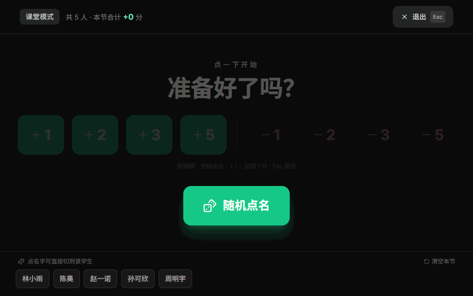
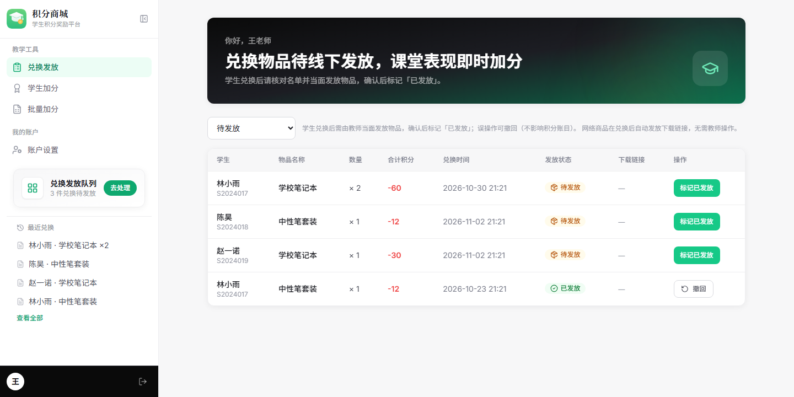
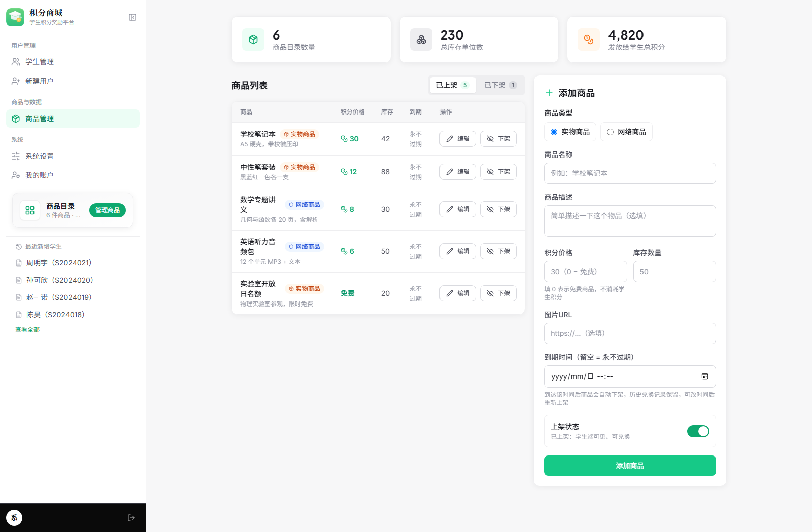
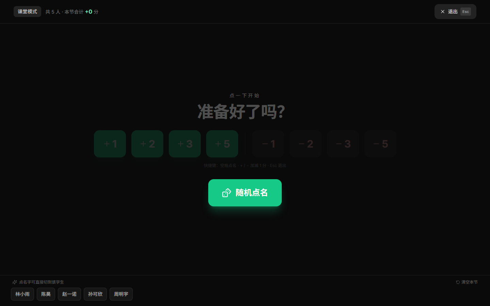
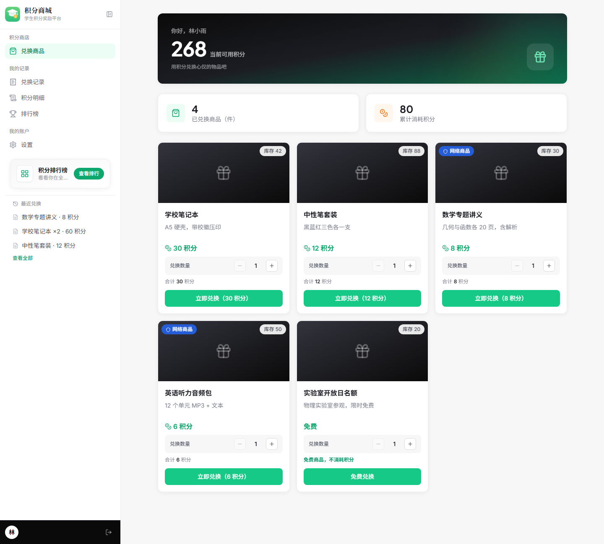
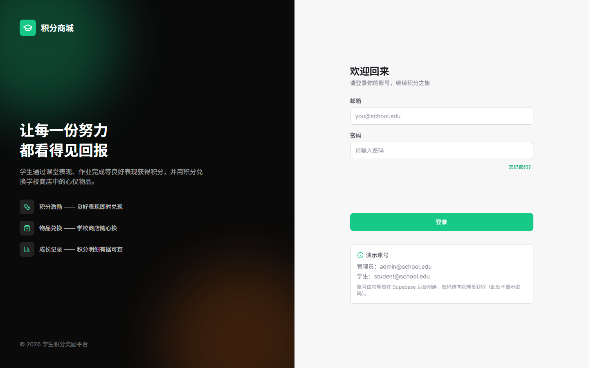
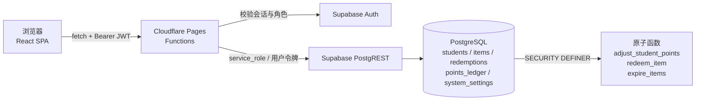

<p align="center">
  <a href="./README.en.md">English</a> | <b>简体中文</b>
</p>

<div align="center">
  

  <h1>积分商城 · 学生积分奖励平台</h1>

  <p>
    <b>老师加分，学生兑换，管理员管货</b> —— 一套可以真正跑在课堂里的校园积分系统。<br/>
    自托管，5 分钟部署，不需要自己的服务器。
  </p>

  <p>
    <a href="https://github.com/GB233-grt/class-app/actions/workflows/ci.yml"></a>
    <a href="./LICENSE"></a>
    
    
    
    
  </p>
</div>

<div align="center">
  
  <sub>30 秒演示：课堂模式随机点名 → 即时加减分 → Excel 批量加分实时预览</sub>
</div>

<br/>

## ⚡ 30 秒跑起来

```bash
git clone https://github.com/GB233-grt/class-app.git && cd class-app
npm install
cp .env.example .env && cp .dev.vars.example .dev.vars   # 填入 Supabase URL 与 anon key
npm run pages:dev                                        # → http://localhost:8788
```

数据库只需在 Supabase **SQL Editor** 里跑两个文件：`database/all-in-one/step1-schema.sql` → `step2-seed.sql`。
完整的建库、建账号步骤见 [快速开始](#快速开始)，遇到问题翻 [Wiki](https://github.com/GB233-grt/class-app/wiki)。

| 角色 | 能做什么 |
| --- | --- |
| 🎒 学生 | 查看积分余额与明细、用积分兑换奖品与学习资料、看排行榜 |
| 👩‍🏫 教师 | 单人加分 / Excel 批量加分、核销线下兑换发放 |
| 🛠️ 管理员 | 商品上下架与分组、到期自动下架、免费商品、账号与系统设置 |

<details>
<summary><b>目录</b>（点击展开）</summary>

- [快速开始](#快速开始)
- [界面预览](#界面预览)
- [功能特性](#功能特性)
- [使用示例](#使用示例)
- [配置说明](#配置说明)
- [架构说明](#架构说明)
- [API 接口](#api-接口)
- [部署到 Cloudflare Pages](#部署到-cloudflare-pages)
- [常见问题](#常见问题)
- [路线图](#路线图) · [更新日志](#更新日志)
- [贡献指南](#贡献指南) · [许可证](#许可证) · [开发工具与致谢](#开发工具与致谢)

</details>

---

## 快速开始

### 0. 环境准备

| 依赖 | 版本 | 说明 |
| --- | --- | --- |
| Node.js | ≥ 18 | 前端构建与本地 Functions 运行时 |
| Supabase | 免费版即可 | 数据库 + 登录认证 |
| Cloudflare | 免费账号 | 仅部署时需要 |

### 1. 安装

```bash
git clone https://github.com/GB233-grt/class-app.git
cd class-app
npm install
```

### 2. 配置环境变量

```bash
# 前端变量（Vite 在构建时注入浏览器）
cp .env.example .env            # Windows PowerShell: Copy-Item .env.example .env

# 本地 Functions 变量（仅在 npm run pages:dev 时读取）
cp .dev.vars.example .dev.vars
```

字段说明见 [配置说明](#配置说明)。两个文件都已在 `.gitignore` 中。

### 3. 初始化数据库

**全新数据库**：Supabase 控制台 → **SQL Editor**，依次执行：

1. `database/all-in-one/step1-schema.sql` —— 建表 + 原子函数 + RLS
2. `database/all-in-one/step2-seed.sql` —— 示例种子数据

**已有数据库升级**：按序号执行 `database/migrations/` 中尚未执行过的脚本：

| 脚本 | 内容 |
| --- | --- |
| `07_teacher_and_fulfillment.sql` | 教师角色 + 按数量兑换 + 发放状态 |
| `08_batch_points_adjust.sql` | 批量积分调整（Excel） |
| `09_item_types.sql` | 商品类型（实物 / 网络）+ 下载链接 |
| `10_system_settings.sql` | 系统配置表（自助修改个人信息的开关） |
| `11_fix_digital_redeem_points.sql` | **修复**：网络商品兑换不扣积分 |
| `12_digital_stock_limit.sql` | **修复**：网络商品按库存限量（含 11 的修复） |
| `13_allow_zero_cost_items.sql` | 允许价格为 0 的免费商品（含 11、12 的修复） |
| `14_item_expiry.sql` | 商品到期自动下架 |

> 11、12、13 都在重写同一个数据库函数，**只需执行最新的那个**（13 已包含 11、12 的全部修复）。

### 4. 创建登录账号

**Authentication → Users → Add user**，逐个创建并设置密码（勾选 **Auto Confirm User**，否则登录会提示邮箱未验证）：

- 管理员：`admin@school.edu`
- 学生：`student@school.edu`、`student2@school.edu`

邮箱需与 `database/seed/` 模板一致；模板通过邮箱子查询把 `students.id` 对齐到 `auth.users.id`。

### 5. 启动

```bash
npm run pages:dev     # 构建并在 http://localhost:8788 启动前端 + 本地 API
```

需要前端热更新时开两个终端：

```bash
npm run pages:dev     # 终端 1：本地 Functions（:8788）
npm run dev           # 终端 2：Vite（:5173，/api 自动代理到 8788）
```

打开 <http://localhost:5173>，用第 4 步创建的账号登录。

### 6. 常用命令

```bash
npm run dev         # 仅前端热更新（API 需另开 pages:dev）
npm run build       # 构建到 dist/
npm run typecheck   # TypeScript 类型检查（前端 + Functions）
npm test            # 单元测试（Vitest）
npm run deploy      # 构建并部署到 Cloudflare Pages
```

---

## 界面预览

| 教师端 · 兑换发放 | 管理端 · 商品管理 |
| --- | --- |
|  |  |

| 课堂模式（投屏） | 学生端 · 兑换商城 |
| --- | --- |
|  |  |

<details>
<summary>登录页</summary>



</details>

> 截图取自真实构建产物，数据为演示用的示例数据（由 `tools/preview-server.mjs` 注入，不需要真实数据库）。
> 重新生成：`npm run build && npm run preview:ui student 8801`，然后截图 `http://localhost:8801`。

---

## 功能特性

### 🎒 学生端

- **积分钱包**：大字号积分卡片 + 姓名问候
- **兑换商城**：卡片网格；售罄显示「已售罄」，积分不够显示「积分不足」
- **兑换记录**：商品名、消耗积分、时间、下载链接、发放状态
- **积分明细**：每笔加/扣分的原因、变动值与变动后余额
- **排行榜**：按积分倒序查看全校排名
- **账户设置**：改密码（旧密码校验）、改昵称/学号（管理员可关闭）、注销账号

### 👩‍🏫 教师端

- **课堂模式**（投屏用）：全屏大按钮，一键随机点名 + 即时加减分；支持 `空格` 点名、`+/-` 加减分、`Esc` 退出，适合希沃大屏与翻页笔
- **兑换发放**：待发放队列，核对学生与商品后标记「已发放」
- **学生加分**：单人加减分，需填写原因（带常见原因联想）
- **批量加分**：Excel **拖拽上传** → 公式实时校验 → 逐行预览（待入账 / 0 分不变更 / 校验失败三类状态）→ 只看问题行 → 确认后单事务入账

### 🛠️ 管理端

- **统计概览**：商品数量、总库存、发放总积分
- **商品管理**：已上架 / 已下架两个分组，随时上下架
- **系统设置**：开关「是否允许学生自助修改昵称 / 学号」
- **账号体系**：新建学生/教师账号，同步创建登录账号

### 🎁 商品能力

| 能力 | 说明 |
| --- | --- |
| 实物商品 | 有库存，兑换后进入「待发放」，由教师线下发出 |
| 网络商品 | 有库存，兑换后**自动发放**下载链接，学生直接下载 |
| 免费商品 | 价格填 **0** 即可，不消耗学生积分，仍按库存限量 |
| 到期自动下架 | 可设置到期时间，到点后自动变为「已下架」，历史记录保留 |
| 库存控制 | 实物与网络商品统一按库存限量，兑完即售罄 |

---

## 使用示例

### 学生：兑换一件网络商品

1. 登录 → 进入「兑换商品」
2. 选择商品，点 **立即兑换**（免费商品显示「免费兑换」）
3. 网络商品立即出现在「兑换记录」中，点链接即可下载；实物商品进入「待发放」

### 教师：给一个班批量加分

1. 「批量加分」→ 上传 Excel（含学号与判分列）
2. 选择判分公式 → 预览命中人数 → 确认入账
3. 学生的「积分明细」立即出现一条加分明细

### 管理员：上架一个限时免费资料

1. 「商品管理」→ 添加商品
2. 类型选 **网络商品**，积分价格填 `0`，库存填 `50`，填下载链接
3. 到期时间选两周后 → 保存
4. 商品出现在「已上架」分组；两周后自动移入「已下架」

### 直接调 API

```bash
# 1) 登录，拿到 access_token
curl -X POST "https://<你的域名>/api/auth/login" \
  -H "Content-Type: application/json" \
  -d '{"email":"student@school.edu","password":"你的密码"}'

# 2) 拉取商品列表
curl "https://<你的域名>/api/items" -H "Authorization: Bearer <access_token>"

# 3) 兑换一个商品
curl -X POST "https://<你的域名>/api/redemptions" \
  -H "Authorization: Bearer <access_token>" \
  -H "Content-Type: application/json" \
  -d '{"item_id":"<商品UUID>","quantity":1}'
```

错误响应统一为 `{ "error": "中文提示" }`。

---

## 配置说明

### 前端变量（`.env`）

| 变量 | 必填 | 类型 | 默认值 | 说明 |
| --- | --- | --- | --- | --- |
| `VITE_SUPABASE_URL` | ✅ | string | — | Supabase 项目 URL |
| `VITE_SUPABASE_ANON_KEY` | ✅ | string | — | Supabase 匿名密钥（可公开） |

获取位置：Supabase 控制台 → **Project Settings → API**。

### 后端变量（`.dev.vars` 本地 / Cloudflare 环境变量 生产）

| 变量 | 必填 | 类型 | 默认值 | 说明 |
| --- | --- | --- | --- | --- |
| `SUPABASE_URL` | ✅ | string | — | 同上 |
| `SUPABASE_ANON_KEY` | ✅ | string | — | 同上 |
| `SUPABASE_SERVICE_ROLE_KEY` | ✅ | **secret** | — | 服务角色密钥，仅后端使用，**切勿泄露或提交** |

> 生产环境请把 `SUPABASE_SERVICE_ROLE_KEY` 配成 Cloudflare 的 **Secret（加密）**，不要用明文 Text。

### 代码内可调参数

| 位置 | 参数 | 默认值 | 说明 |
| --- | --- | --- | --- |
| `src/lib/constants.ts` | `POINT_REASONS` | 一组常见原因 | 加分原因下拉列表，直接追加即可生效 |
| `src/lib/validation.ts` | 密码强度规则 | 8 位 + 大小写 + 数字 + 特殊字符 | 修改密码时的校验规则 |

---

## 架构说明

### 目录结构

```text
class-app/
├── database/                      # 数据库脚本（Supabase SQL Editor 手动执行）
│   ├── migrations/                # 增量迁移 01 → 14
│   ├── all-in-one/                # 全新库一键建表 + 种子
│   ├── tests/                     # 数据库函数测试（事务内运行，自动回滚）
│   └── seed/                      # 种子数据模板（不自动执行）
├── functions/                     # Cloudflare Pages Functions（后端）
│   ├── api/
│   │   ├── _middleware.ts         # 统一 CORS 与异常兜底
│   │   ├── auth/                  # 登录 / 刷新 / 登出 / 重置与修改密码
│   │   ├── items/                 # 商品增删改查 + 上下架切换
│   │   ├── students/              # 名单 / 建号 / 加减分 / 批量加减分
│   │   ├── redemptions/           # 兑换 / 记录 / 发放状态
│   │   ├── ledger/                # 积分明细
│   │   ├── user/                  # 个人资料 / 注销 / 可见系统配置
│   │   ├── admin/                 # 系统配置管理（仅管理员）
│   │   ├── leaderboard.ts         # 排行榜
│   │   └── stats.ts               # 统计概览
│   └── lib/                       # 认证鉴权、HTTP 工具、Supabase 客户端工厂
├── docs/screenshots/              # README 截图
├── public/                        # 静态资源（Logo、导入模板）
├── src/                           # 前端（React + Vite）
│   ├── api/                       # Fetch 客户端与接口定义
│   ├── components/                # common / layout / feature 三层
│   ├── hooks/                     # useAuth / useItems / useStudents / useToast …
│   ├── lib/                       # 校验规则、常量、工具函数（含单元测试）
│   ├── pages/                     # 三个仪表盘 + 登录页
│   └── types/                     # TypeScript 类型
├── tools/preview-server.mjs       # 本地预览服务器（生成 README 截图用）
├── .github/workflows/ci.yml       # CI：typecheck + test + build
├── index.html
├── wrangler.toml                  # Cloudflare Pages 配置
├── .env.example                   # 前端变量模板
└── .dev.vars.example              # 后端变量模板
```

### 数据流



**分层原则**：前端 `api 客户端 → hooks → 组件`，后端 `路由 → 中间件（鉴权） → Supabase 客户端工厂`，两侧都只依赖下一层，便于替换与测试。

### 数据一致性

积分与库存的写操作全部封装在数据库函数里，**单事务原子完成**，并发下不会超卖或错账：

- `adjust_student_points`：锁定学生行 → 校验余额 → 更新余额 → 写积分明细
- `redeem_item`：锁定商品行 → 校验上架 / 库存 / 积分 → 扣积分扣库存 → 写兑换记录（**商品名与单价快照**）→ 写积分明细
- `expire_items`：把 `expires_at` 已过的上架商品批量下架（惰性清理，列表与兑换接口都会先调用）

兑换记录保存商品名与价格快照，后续改价或下架都不会让历史记录失真。

### 测试

| 层级 | 位置 | 运行方式 |
| --- | --- | --- |
| 前端单元测试 | `src/lib/*.test.ts`（40 个用例：表单校验、密码强度、日期时间往返转换） | `npm test` |
| 数据库函数 | `database/tests/redeem_item.test.sql`（兑换扣分/扣库存/库存不足/积分不足/免费商品 5 个场景） | 粘贴进 Supabase SQL Editor 执行，事务内运行并自动回滚 |
| 持续集成 | `.github/workflows/ci.yml` | push / PR 自动跑 typecheck + test + build |

### 权限模型（区域隔离）

四级角色 + 树形区域，判断全部在服务端完成，前端只控制菜单显隐。

| 角色 | 能做什么 |
| --- | --- |
| super_admin | 全部区域；管理区域结构、区域授权、用户角色 |
| dmin | 仅被授权区域（含所有子孙区域）内的账号与数据 |
| 	eacher | 仅被授权区域（含子孙）内的加分 / 发放 |
| student | 只能看自己的数据 |

- **区域**：`regions` 用 `parent_id` 自关联（校区 → 年级 → 班级），可任意分层
- **授权**：`region_members(user_id, region_id)`；授权父级自动覆盖全部子级
- **学生归属**：`students.region_id`；未分区的账号只有超级管理员可见
- **拦截点**：`functions/lib/rbac.ts` + 各接口的 `assertStudentAllowed` / `regionFilter`，越权返回 403

``sql
-- 升级已有库后：给自己所在的账号提权（脚本会自动把最早的管理员设为超管）
select name, role from students order by created_at;
update students set role = 'super_admin' where email = 'admin@school.edu';
``

### 安全模型

- 所有写操作经后端完成，浏览器拿不到 `service_role` 密钥
- 已启用 RLS：普通用户凭证对业务表只有 SELECT 权限，且只能读自己的记录
- 学生侧变更（兑换、调分）走 `SECURITY DEFINER` 函数，函数内部再次校验 `auth.uid()`
- 改密码与注销账号都要求**先校验旧密码**，不依赖邮箱验证码
- 密码由 Supabase Auth 加盐哈希存储，服务端也无法查看明文

---

## API 接口

除登录相关接口外，均需请求头 `Authorization: Bearer <Access Token>`（前端 Fetch 客户端已自动附加）。

<details>
<summary><b>展开完整接口列表</b></summary>

### 认证

| 方法 | 路径 | 说明 | 权限 |
| --- | --- | --- | --- |
| POST | `/api/auth/login` | 邮箱密码登录 | 公开 |
| POST | `/api/auth/refresh` | 刷新访问令牌 | 公开 |
| POST | `/api/auth/logout` | 登出 | 登录用户 |
| GET | `/api/auth/me` | 当前用户资料 | 登录用户 |
| POST | `/api/auth/reset-password` | 发送重置密码邮件 | 公开 |
| POST | `/api/auth/change-password` | 修改密码（旧密码校验） | 登录用户 |

### 商品

| 方法 | 路径 | 说明 | 权限 |
| --- | --- | --- | --- |
| GET | `/api/items` | 商品列表（学生仅见上架） | 登录用户 |
| POST | `/api/items` | 添加商品 | 管理员 |
| PUT | `/api/items/:id` | 编辑商品 | 管理员 |
| DELETE | `/api/items/:id` | 软删除（下架） | 管理员 |
| POST | `/api/items/:id/status` | 上架 / 下架切换 | 管理员 |

### 学生与积分

| 方法 | 路径 | 说明 | 权限 |
| --- | --- | --- | --- |
| GET | `/api/students` | 学生列表 | 教职工 |
| POST | `/api/students` | 创建账号 | 管理员 |
| POST | `/api/students/award` | 单人加减分 | 教职工 |
| POST | `/api/students/award-batch` | 批量加减分 | 教职工 |
| GET | `/api/ledger/:studentId` | 积分明细 | 本人 / 教职工 |
| GET | `/api/leaderboard` | 积分排行榜 | 登录用户 |

### 兑换与统计

| 方法 | 路径 | 说明 | 权限 |
| --- | --- | --- | --- |
| POST | `/api/redemptions` | 兑换商品 | 登录用户 |
| GET | `/api/redemptions` | 全部兑换记录 | 教职工 |
| GET | `/api/redemptions/:studentId` | 某学生兑换记录 | 本人 / 教职工 |
| POST | `/api/redemptions/:id/status` | 更新发放状态 | 教职工 |
| GET | `/api/stats` | 统计概览 | 管理员 |

### 个人中心与系统设置

| 方法 | 路径 | 说明 | 权限 |
| --- | --- | --- | --- |
| GET | `/api/user` | 当前用户资料 | 登录用户 |
| PUT | `/api/user` | 修改昵称 / 学号 | 登录用户（受开关控制） |
| DELETE | `/api/user` | 注销账号（旧密码校验） | 登录用户 |
| GET | `/api/user/system-settings` | 读取可见的系统配置 | 登录用户 |
| GET | `/api/admin/system-settings` | 全部系统配置 | 管理员 |
| POST | `/api/admin/system-settings` | 更新系统配置 | 管理员 |

</details>

---

## 部署到 Cloudflare Pages

1. 将代码推送到 GitHub / GitLab
2. Cloudflare 控制台 → **Workers & Pages → Create → Pages → Connect to Git**
3. 构建配置：

   | 项 | 值 |
   | --- | --- |
   | Framework preset | Vite（或 None） |
   | Build command | `npm run build` |
   | Build output directory | `dist` |

4. **Settings → Environment variables** 添加生产变量：

   | 变量 | 类型 |
   | --- | --- |
   | `SUPABASE_URL` | Text |
   | `SUPABASE_ANON_KEY` | Text |
   | `SUPABASE_SERVICE_ROLE_KEY` | **Secret** |

5. 点击 **Deploy**；`functions/` 会被自动识别为 Pages Functions
6. （可选）**Custom domains** 绑定自有域名

### 免费项目保活

Supabase 免费套餐连续 7 天无活动会被暂停。仓库自带 `.github/workflows/keep-alive.yml`，每天 UTC 12:00 自动打一次轻量请求保活：

1. **Settings → Secrets and variables → Actions → Variables** 新增 `SUPABASE_URL`（值形如 `https://xxxx.supabase.co`）
2. 可选再加 `SUPABASE_ANON_KEY`（带上 apikey 头，返回 200 更干净）
3. **Actions → Supabase Keep-Alive → Run workflow** 手动跑一次验证

> GitHub 会在仓库 60 天无提交后自动停用定时工作流，长期不动的话记得偶尔提交或手动触发一次。

也可以命令行部署：

```bash
npm run deploy      # 首次需先 npx wrangler login
```

---

## 常见问题

**登录提示「邮箱或密码错误」？**
确认已在 Authentication → Users 创建该邮箱用户，且邮箱已确认（创建时勾选 Auto Confirm）。

**登录提示「用户资料不存在」？**
`students` 表里没有该 Auth 用户对应记录。执行 `database/seed/01_create_admin.sql`、`02_create_students.sql`，或手动插入（`id` 填 Auth 用户 ID）。

**提示「服务端缺少 SUPABASE_SERVICE_ROLE_KEY」？**
本地 `.dev.vars` 或 Cloudflare 环境变量未配置服务角色密钥，补齐后重启 / 重新部署。

**本地 `npm run dev` 时接口 404？**
`vite dev` 只启动前端。请同时运行 `npm run pages:dev`，或直接用 `npm run pages:dev` 打开 8788 端口。

**兑换提示「积分不足 / 库存不足，仅剩 N 件」？**
请管理员加分或补充库存。并发场景下数据库函数会保证不超卖。

**网络商品的「库存数量」和「下载次数限制」有什么区别？**
`库存数量` 决定该商品能被兑换多少次（兑完即售罄）；`下载次数限制`（`download_limit`）目前**仅保存、未生效**——系统没有计数的下载代理接口，学生拿到的是原始链接。需要真正限制下载次数时，需额外实现 `/api/downloads/:redemptionId`。

**商品到期后为什么还在「已上架」？**
到期清理是惰性的：需要有人访问商品列表或发起兑换才会触发。刷新一次商品管理页即可看到它移入「已下架」。

**学生能绕过前端直接改积分吗？**
不能。RLS 已禁止普通凭证写业务表，所有写操作必须走后端接口与数据库函数。

---

## 路线图

- [x] 三端工作台（学生 / 教师 / 管理员）
- [x] 原子积分与库存，防超卖
- [x] 实物商品 + 网络商品（自动发卡）
- [x] 批量 Excel 加分
- [x] 商品分组上下架、免费商品、到期自动下架
- [x] 账户设置（改密码 / 改资料 / 注销）
- [x] 单元测试与 CI
- [ ] 下载次数限制（带计数的下载代理）
- [ ] 兑换记录导出 Excel
- [ ] 站内消息通知（兑换成功 / 发放提醒）
- [ ] 移动端 PWA

欢迎在 Issues 里补充你需要的功能。

---

## 更新日志

按时间倒序的提交记录见 [Commits](https://github.com/GB233-grt/class-app/commits/main)。
数据库每次升级后请重新部署（`npm run deploy`），使后端与表结构保持一致。

---

## 贡献指南

详细规则见 **[CONTRIBUTING.md](./CONTRIBUTING.md)**，这里只列要点：

1. Fork 并从 `main` 切分支：`git checkout -b feat/your-feature`
2. 提交前跑通 `npm run typecheck`、`npm test`、`npm run build`
3. 数据库结构变更**新增**迁移脚本，不要改已发布的旧脚本
4. 提交信息用 `feat:` / `fix:` / `docs:` / `refactor:` 前缀
5. 发起 PR 并说明动机、影响范围与验证方式

**第一次参与？** 带 [`good first issue`](https://github.com/GB233-grt/class-app/labels/good%20first%20issue) 标签的 Issue 都是刻意留出的入门任务，直接回一句「我来试试」即可。

---

## 许可证

本项目基于 [MIT License](./LICENSE) 开源。

---

## 开发工具与致谢

本项目的设计与实现由作者完成并负责；开发过程中使用了以下 AI 编程助手作为**工具**，用于辅助编码、方案讨论与文档撰写。所有设计决策、代码审阅与最终实现均由作者把关。

| 工具 | 参与内容 |
| --- | --- |
| 🧠 [智谱 GLM](https://www.zhipuai.cn/) | 参与设计、实现、文档与编程（辅助） |
| 🐋 [深度求索 DeepSeek](https://www.deepseek.com/) | 参与设计、实现、文档与编程（辅助） |
| ☁️ [阿里千问 Qwen](https://tongyi.aliyun.com/qianwen/) | 提供结构目录与基础指导 |
| 🔬 [上海人工智能实验室](https://www.shlab.org.cn/) | 参与设计、实现、文档与编程（辅助） |

### 技术与服务致谢

- [React](https://react.dev) · [Vite](https://vitejs.dev) · [Tailwind CSS](https://tailwindcss.com)
- [Lucide](https://lucide.dev) 图标库 · [Vitest](https://vitest.dev) 测试框架
- [Supabase](https://supabase.com) 提供的托管 PostgreSQL 与认证
- [Cloudflare Pages](https://pages.cloudflare.com) 提供的静态托管与边缘函数
- 以及所有在课堂上真正使用它的老师和同学

<p align="center"><sub>如果这个项目对你有帮助，欢迎点一个 ⭐ Star</sub></p>
