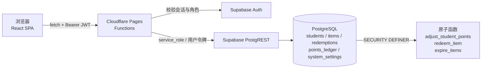

<div align="center">
  
</div>

<h1 align="center">积分商城 · 学生积分奖励平台</h1>

<p align="center">
  老师给学生的良好表现加积分，学生用积分兑换奖品与学习资料。<br/>
  一个自托管的校园积分商城，5 分钟部署，无需自建服务器。
</p>

<p align="center">
  <a href="#快速开始"></a>
  <a href="./LICENSE"></a>
  
  
  
  
  
</p>

<p align="center">
  <sub>学生端 / 教师端 / 管理端三套工作台 · 原子化积分与库存 · 行级安全（RLS） · 全中文界面</sub>
</p>

---

## 目录

- [项目简介](#项目简介)
- [功能特性](#功能特性)
- [快速开始](#快速开始)
- [使用示例](#使用示例)
- [配置说明](#配置说明)
- [架构说明](#架构说明)
  - [目录结构](#目录结构)
  - [数据流](#数据流)
  - [数据一致性](#数据一致性)
  - [安全模型](#安全模型)
- [API 接口](#api-接口)
- [部署到 Cloudflare Pages](#部署到-cloudflare-pages)
- [常见问题](#常见问题)
- [路线图](#路线图)
- [更新日志](#更新日志)
- [贡献指南](#贡献指南)
- [许可证](#许可证)
- [贡献者](#贡献者)
- [致谢](#致谢)

---

## 项目简介

学校里的积分奖励往往停留在纸面：加分记在本子上、兑奖靠老师口头确认、统计要手工汇总。
本项目把它做成一套可以直接部署上线的 Web 应用——**老师加分、学生兑换、管理员管货**，全流程留痕、数据可查。

- **解决什么问题**：把「课堂表现 → 积分 → 兑换奖品」这条链路搬到线上，避免漏记、错记与兑奖扯皮。
- **谁在用**：三类角色共用一套系统 —— 学生（兑换）、教师（加分 / 发放）、管理员（商品与账号管理）。
- **怎么部署**：前端与接口部署在 Cloudflare Pages，数据与登录托管在 Supabase，**无需自建服务器**。

> 全部界面文案为中文；数据库为 PostgreSQL；部署目标为 Cloudflare（Pages + Pages Functions）。

---

## 功能特性

### 🎒 学生端

- **积分钱包**：大字号积分卡片 + 姓名问候，一眼看余额
- **兑换商城**：卡片网格展示上架商品；售罄显示「已售罄」，积分不够显示「积分不足」
- **兑换记录**：历史表格，含商品名、消耗积分、时间、下载链接、发放状态
- **积分明细**：每一笔加/扣分的原因、变动值、变动后余额
- **排行榜**：按积分倒序看全校排名
- **账户设置**：改密码（旧密码校验）、改昵称/学号（管理员可关闭）、注销账号

### 👩‍🏫 教师端

- **兑换发放**：待发放队列，核对学生与商品后标记「已发放」
- **学生加分**：单人加减分，需填写原因（带常见原因联想）
- **批量加分**：上传 Excel，按公式批量判分入账，一次处理一个班

### 🛠️ 管理端

- **统计概览**：商品数量、总库存、发放总积分
- **商品管理**：已上架 / 已下架两个分组，随时上下架；支持实物商品与网络商品
- **系统设置**：开关「是否允许学生自助修改昵称 / 学号」
- **账号体系**：新建学生/教师账号，同步创建登录账号

### 🎁 商品能力

| 能力 | 说明 |
| --- | --- |
| 实物商品 | 有库存，兑换后进入「待发放」，由教师线下发出 |
| 网络商品 | 有库存，兑换后**自动发放**下载链接，学生直接下载 |
| 免费商品 | 价格填 **0** 即可，不消耗学生积分，仍按库存限量 |
| 到期自动下架 | 可设置到期时间，到点后自动变为「已下架」，历史记录保留 |
| 库存控制 | 实物与网络商品统一按库存限量，兑完即售罄 |

---

## 快速开始

### 0. 环境准备

| 依赖 | 版本 | 说明 |
| --- | --- | --- |
| Node.js | ≥ 18 | 前端构建与本地 Functions 运行时 |
| Supabase | 免费版即可 | 数据库 + 登录认证 |
| Cloudflare | 免费账号 | 仅部署时需要 |

### 1. 克隆并安装

```bash
git clone https://github.com/GB233-grt/class-app.git
cd class-app
npm install
```

### 2. 配置环境变量

```bash
# 前端变量（Vite 在构建时注入浏览器）
cp .env.example .env            # Windows PowerShell: Copy-Item .env.example .env

# 本地 Functions 变量（仅在 npm run pages:dev 时读取）
cp .dev.vars.example .dev.vars
```

两份文件的字段说明见 [配置说明](#配置说明)。两个文件都已在 `.gitignore` 中，不会进入版本库。

### 3. 初始化数据库

**全新数据库**：进入 Supabase 控制台 → **SQL Editor**，依次执行：

1. `database/all-in-one/step1-schema.sql` —— 建表 + 原子函数 + RLS
2. `database/all-in-one/step2-seed.sql` —— 示例种子数据

**已有数据库升级**：按序号执行 `database/migrations/` 中尚未执行过的脚本：

| 脚本 | 内容 |
| --- | --- |
| `07_teacher_and_fulfillment.sql` | 教师角色 + 按数量兑换 + 发放状态 |
| `08_batch_points_adjust.sql` | 批量积分调整（Excel） |
| `09_item_types.sql` | 商品类型（实物 / 网络）+ 下载链接 |
| `10_system_settings.sql` | 系统配置表（自助修改个人信息的开关） |
| `11_fix_digital_redeem_points.sql` | **修复**：网络商品兑换不扣积分 |
| `12_digital_stock_limit.sql` | **修复**：网络商品按库存限量（含 11 的修复） |
| `13_allow_zero_cost_items.sql` | 允许价格为 0 的免费商品（含 11、12 的修复） |
| `14_item_expiry.sql` | 商品到期自动下架 |

> 11、12、13 都在重写同一个数据库函数，**只需执行最新的那个**（13 已包含 11、12 的全部修复）。

### 4. 创建登录账号

进入 **Authentication → Users → Add user**，逐个创建并设置密码（勾选 **Auto Confirm User**，否则登录会提示邮箱未验证）：

- 管理员：`admin@school.edu`
- 学生：`student@school.edu`、`student2@school.edu`

邮箱必须与 `database/seed/` 模板中的一致；模板通过邮箱子查询把 `students.id` 对齐到 `auth.users.id`。

### 5. 启动

```bash
npm run pages:dev     # 构建并在 http://localhost:8788 启动前端 + 本地 API
```

需要前端热更新时开两个终端：

```bash
npm run pages:dev     # 终端 1：本地 Functions（:8788）
npm run dev           # 终端 2：Vite（:5173，/api 自动代理到 8788）
```

打开 <http://localhost:5173>，用第 4 步创建的账号登录。

### 6. 常用命令

```bash
npm run dev         # 仅前端热更新（API 需另开 pages:dev）
npm run build       # 构建到 dist/
npm run typecheck   # TypeScript 类型检查（前端 + Functions）
npm run deploy      # 构建并部署到 Cloudflare Pages
```

---

## 使用示例

### 学生：兑换一件网络商品

1. 登录 → 进入「积分商店」
2. 选择商品，点 **立即兑换**（免费商品显示「免费兑换」）
3. 网络商品立即出现在「兑换记录」中，点链接即可下载；实物商品进入「待发放」，等待老师发放

### 教师：给一个班批量加分

1. 「批量加分」→ 上传 Excel（含学号与判分列）
2. 选择判分公式 → 预览命中人数 → 确认入账
3. 学生的「积分明细」立即出现一条加分明细

### 管理员：上架一个限时免费资料

1. 「商品管理」→ 添加商品
2. 类型选 **网络商品**，积分价格填 `0`，库存填 `50`，填下载链接
3. 到期时间选两周后 → 保存
4. 商品出现在「已上架」分组；两周后自动移入「已下架」

### 直接调 API

```bash
# 1) 登录，拿到 access_token
curl -X POST "https://<你的域名>/api/auth/login" \
  -H "Content-Type: application/json" \
  -d '{"email":"student@school.edu","password":"你的密码"}'

# 2) 拉取商品列表
curl "https://<你的域名>/api/items" \
  -H "Authorization: Bearer <access_token>"

# 3) 兑换一个商品
curl -X POST "https://<你的域名>/api/redemptions" \
  -H "Authorization: Bearer <access_token>" \
  -H "Content-Type: application/json" \
  -d '{"item_id":"<商品UUID>","quantity":1}'
```

错误响应统一为 `{ "error": "中文提示" }`。

---

## 配置说明

### 前端变量（`.env`）

| 变量 | 必填 | 类型 | 默认值 | 说明 |
| --- | --- | --- | --- | --- |
| `VITE_SUPABASE_URL` | ✅ | string | — | Supabase 项目 URL |
| `VITE_SUPABASE_ANON_KEY` | ✅ | string | — | Supabase 匿名密钥（可公开） |

获取位置：Supabase 控制台 → **Project Settings → API**。

### 后端变量（`.dev.vars` 本地 / Cloudflare 环境变量 生产）

| 变量 | 必填 | 类型 | 默认值 | 说明 |
| --- | --- | --- | --- | --- |
| `SUPABASE_URL` | ✅ | string | — | 同上 |
| `SUPABASE_ANON_KEY` | ✅ | string | — | 同上 |
| `SUPABASE_SERVICE_ROLE_KEY` | ✅ | **secret** | — | 服务角色密钥，仅后端使用，**切勿泄露或提交** |

> 生产环境请把 `SUPABASE_SERVICE_ROLE_KEY` 配成 Cloudflare 的 **Secret（加密）**，不要用明文 Text。

### 代码内可调参数

| 位置 | 参数 | 默认值 | 说明 |
| --- | --- | --- | --- |
| `src/lib/constants.ts` | `POINT_REASONS` | 一组常见原因 | 加分原因下拉列表，直接追加即可生效 |
| `src/lib/validation.ts` | 密码强度规则 | 8 位 + 大小写 + 数字 + 特殊字符 | 修改密码时的校验规则 |

---

## 架构说明

### 目录结构

```text
class-app/
├── database/                      # 数据库脚本（Supabase SQL Editor 手动执行）
│   ├── migrations/                # 增量迁移 01 → 14
│   ├── all-in-one/                # 全新库一键建表 + 种子
│   └── seed/                      # 种子数据模板（不自动执行）
├── functions/                     # Cloudflare Pages Functions（后端）
│   ├── api/
│   │   ├── _middleware.ts         # 统一 CORS 与异常兜底
│   │   ├── auth/                  # 登录 / 刷新 / 登出 / 重置与修改密码
│   │   ├── items/                 # 商品增删改查 + 上下架切换
│   │   ├── students/              # 名单 / 建号 / 加减分 / 批量加减分
│   │   ├── redemptions/           # 兑换 / 记录 / 发放状态
│   │   ├── ledger/                # 积分明细
│   │   ├── user/                  # 个人资料 / 注销 / 可见系统配置
│   │   ├── admin/                 # 系统配置管理（仅管理员）
│   │   ├── leaderboard.ts         # 排行榜
│   │   └── stats.ts               # 统计概览
│   └── lib/                       # 认证鉴权、HTTP 工具、Supabase 客户端工厂
├── public/                        # 静态资源（Logo、导入模板）
├── src/                           # 前端（React + Vite）
│   ├── api/                       # Fetch 客户端与接口定义
│   ├── components/                # common / layout / feature 三层
│   ├── hooks/                     # useAuth / useItems / useStudents / useToast …
│   ├── lib/                       # 校验规则、常量、工具函数
│   ├── pages/                     # 三个仪表盘 + 登录页
│   └── types/                     # TypeScript 类型
├── index.html
├── wrangler.toml                  # Cloudflare Pages 配置
├── .env.example                   # 前端变量模板
└── .dev.vars.example              # 后端变量模板
```

### 数据流



**分层原则**：前端 `api 客户端 → hooks → 组件`，后端 `路由 → 中间件（鉴权） → Supabase 客户端工厂`，两侧都只依赖下一层，便于替换与测试。

### 数据一致性

积分与库存的写操作全部封装在数据库函数里，**单事务原子完成**，并发下不会超卖或错账：

- `adjust_student_points`：锁定学生行 → 校验余额 → 更新余额 → 写积分明细
- `redeem_item`：锁定商品行 → 校验上架 / 库存 / 积分 → 扣积分扣库存 → 写兑换记录（**商品名与单价快照**）→ 写积分明细
- `expire_items`：把 `expires_at` 已过的上架商品批量下架（惰性清理，列表与兑换接口都会先调用）

兑换记录保存商品名与价格快照，后续改价或下架都不会让历史记录失真。

### 安全模型

- 所有写操作经后端完成，浏览器拿不到 `service_role` 密钥
- 已启用 RLS：普通用户凭证对业务表只有 SELECT 权限，且只能读自己的记录
- 学生侧变更（兑换、调分）走 `SECURITY DEFINER` 函数，函数内部再次校验 `auth.uid()`
- 改密码与注销账号都要求**先校验旧密码**，不依赖邮箱验证码
- 密码由 Supabase Auth 加盐哈希存储，服务端也无法查看明文

---

## API 接口

除登录相关接口外，均需请求头 `Authorization: Bearer <Access Token>`（前端 Fetch 客户端已自动附加）。

<details>
<summary><b>展开完整接口列表</b></summary>

### 认证

| 方法 | 路径 | 说明 | 权限 |
| --- | --- | --- | --- |
| POST | `/api/auth/login` | 邮箱密码登录 | 公开 |
| POST | `/api/auth/refresh` | 刷新访问令牌 | 公开 |
| POST | `/api/auth/logout` | 登出 | 登录用户 |
| GET | `/api/auth/me` | 当前用户资料 | 登录用户 |
| POST | `/api/auth/reset-password` | 发送重置密码邮件 | 公开 |
| POST | `/api/auth/change-password` | 修改密码（旧密码校验） | 登录用户 |

### 商品

| 方法 | 路径 | 说明 | 权限 |
| --- | --- | --- | --- |
| GET | `/api/items` | 商品列表（学生仅见上架） | 登录用户 |
| POST | `/api/items` | 添加商品 | 管理员 |
| PUT | `/api/items/:id` | 编辑商品 | 管理员 |
| DELETE | `/api/items/:id` | 软删除（下架） | 管理员 |
| POST | `/api/items/:id/status` | 上架 / 下架切换 | 管理员 |

### 学生与积分

| 方法 | 路径 | 说明 | 权限 |
| --- | --- | --- | --- |
| GET | `/api/students` | 学生列表 | 教职工 |
| POST | `/api/students` | 创建账号 | 管理员 |
| POST | `/api/students/award` | 单人加减分 | 教职工 |
| POST | `/api/students/award-batch` | 批量加减分 | 教职工 |
| GET | `/api/ledger/:studentId` | 积分明细 | 本人 / 教职工 |
| GET | `/api/leaderboard` | 积分排行榜 | 登录用户 |

### 兑换与统计

| 方法 | 路径 | 说明 | 权限 |
| --- | --- | --- | --- |
| POST | `/api/redemptions` | 兑换商品 | 登录用户 |
| GET | `/api/redemptions` | 全部兑换记录 | 教职工 |
| GET | `/api/redemptions/:studentId` | 某学生兑换记录 | 本人 / 教职工 |
| POST | `/api/redemptions/:id/status` | 更新发放状态 | 教职工 |
| GET | `/api/stats` | 统计概览 | 管理员 |

### 个人中心与系统设置

| 方法 | 路径 | 说明 | 权限 |
| --- | --- | --- | --- |
| GET | `/api/user` | 当前用户资料 | 登录用户 |
| PUT | `/api/user` | 修改昵称 / 学号 | 登录用户（受开关控制） |
| DELETE | `/api/user` | 注销账号（旧密码校验） | 登录用户 |
| GET | `/api/user/system-settings` | 读取可见的系统配置 | 登录用户 |
| GET | `/api/admin/system-settings` | 全部系统配置 | 管理员 |
| POST | `/api/admin/system-settings` | 更新系统配置 | 管理员 |

</details>

---

## 部署到 Cloudflare Pages

1. 将代码推送到 GitHub / GitLab
2. Cloudflare 控制台 → **Workers & Pages → Create → Pages → Connect to Git**
3. 构建配置：

   | 项 | 值 |
   | --- | --- |
   | Framework preset | Vite（或 None） |
   | Build command | `npm run build` |
   | Build output directory | `dist` |

4. **Settings → Environment variables** 添加生产变量：

   | 变量 | 类型 |
   | --- | --- |
   | `SUPABASE_URL` | Text |
   | `SUPABASE_ANON_KEY` | Text |
   | `SUPABASE_SERVICE_ROLE_KEY` | **Secret** |

5. 点击 **Deploy**；`functions/` 会被自动识别为 Pages Functions
6. （可选）**Custom domains** 绑定自有域名

也可以命令行部署：

```bash
npm run deploy      # 首次需先 npx wrangler login
```

---

## 常见问题

**登录提示「邮箱或密码错误」？**
确认已在 Authentication → Users 创建该邮箱用户，且邮箱已确认（创建时勾选 Auto Confirm）。

**登录提示「用户资料不存在」？**
`students` 表里没有该 Auth 用户对应记录。执行 `database/seed/01_create_admin.sql`、`02_create_students.sql`，或手动插入（`id` 填 Auth 用户 ID）。

**提示「服务端缺少 SUPABASE_SERVICE_ROLE_KEY」？**
本地 `.dev.vars` 或 Cloudflare 环境变量未配置服务角色密钥，补齐后重启 / 重新部署。

**本地 `npm run dev` 时接口 404？**
`vite dev` 只启动前端。请同时运行 `npm run pages:dev`，或直接用 `npm run pages:dev` 打开 8788 端口。

**兑换提示「积分不足 / 库存不足，仅剩 N 件」？**
请管理员加分或补充库存。并发场景下数据库函数会保证不超卖。

**网络商品的「库存数量」和「下载次数限制」有什么区别？**
`库存数量` 决定该商品能被兑换多少次（兑完即售罄）；`下载次数限制`（`download_limit`）目前**仅保存、未生效**——系统没有计数的下载代理接口，学生拿到的是原始链接。需要真正限制下载次数时，需额外实现 `/api/downloads/:redemptionId`。

**商品到期后为什么还在「已上架」？**
到期清理是惰性的：需要有人访问商品列表或发起兑换才会触发。刷新一次商品管理页即可看到它移入「已下架」。

**学生能绕过前端直接改积分吗？**
不能。RLS 已禁止普通凭证写业务表，所有写操作必须走后端接口与数据库函数。

---

## 路线图

- [x] 三端工作台（学生 / 教师 / 管理员）
- [x] 原子积分与库存，防超卖
- [x] 实物商品 + 网络商品（自动发卡）
- [x] 批量 Excel 加分
- [x] 商品分组上下架、免费商品、到期自动下架
- [x] 账户设置（改密码 / 改资料 / 注销）
- [ ] 下载次数限制（带计数的下载代理）
- [ ] 兑换记录导出 Excel
- [ ] 站内消息通知（兑换成功 / 发放提醒）
- [ ] 移动端 PWA

欢迎在 Issues 里补充你需要的功能。

---

## 更新日志

按时间倒序的提交记录见 [Commits](https://github.com/GB233-grt/class-app/commits/main)。
数据库每次升级后请重新部署（`npm run deploy`），使后端与表结构保持一致。

---

## 贡献指南

1. Fork 本仓库并从 `main` 切出功能分支：`git checkout -b feat/your-feature`
2. 安装依赖并启动本地环境（见 [快速开始](#快速开始)）
3. 提交前请确保通过检查：

   ```bash
   npm run typecheck
   npm run build
   ```

4. 涉及数据库结构变更时，**新增**一个 `database/migrations/NN_xxx.sql` 增量脚本，不要修改已发布的旧脚本
5. 提交信息建议使用 `feat:` / `fix:` / `docs:` / `refactor:` 前缀
6. 发起 Pull Request，说明改动动机、影响范围与验证方式

代码风格：TypeScript 严格模式、函数式组件 + Hooks、中文注释、Tailwind 原子类。

---

## 许可证

本项目基于 [MIT License](./LICENSE) 开源。

---

## 贡献者

本项目的设计、实现与文档，由作者与以下 AI 助手协作完成：

| 贡献者 | 说明 |
| --- | --- |
| 🧠 [智谱 GLM](https://www.zhipuai.cn/) | 参与设计、实现、文档与编程 |
| 🐋 [深度求索 DeepSeek](https://www.deepseek.com/) | 参与设计、实现、文档与编程 |
| ☁️ [阿里千问 Qwen](https://tongyi.aliyun.com/qianwen/) | 提供结构目录与基础指导 |
| 🔬 [上海人工智能实验室](https://www.shlab.org.cn/) | 参与设计、实现、文档与编程 |

---

## 致谢

- [React](https://react.dev) · [Vite](https://vitejs.dev) · [Tailwind CSS](https://tailwindcss.com)
- [Lucide](https://lucide.dev) 图标库
- [Supabase](https://supabase.com) 提供的托管 PostgreSQL 与认证
- [Cloudflare Pages](https://pages.cloudflare.com) 提供的静态托管与边缘函数
- 以及所有在课堂上真正使用它的老师和同学

<p align="center"><sub>如果这个项目对你有帮助，欢迎点一个 ⭐ Star</sub></p>
