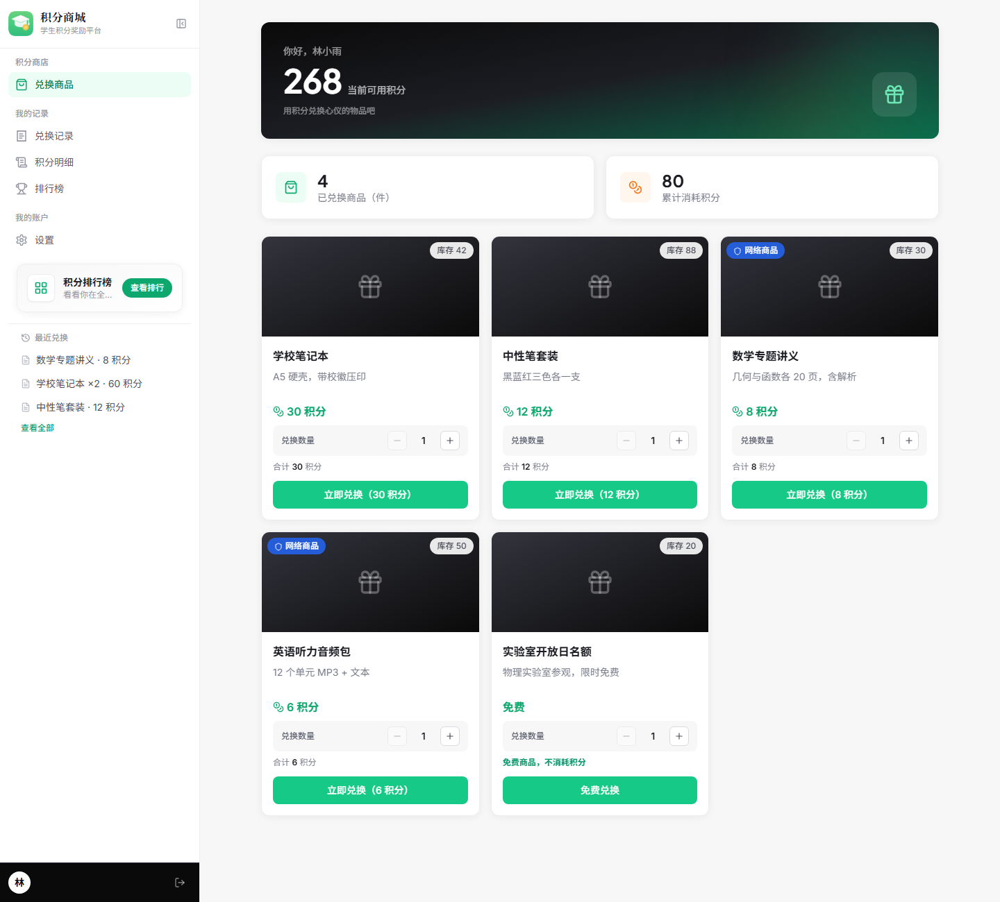
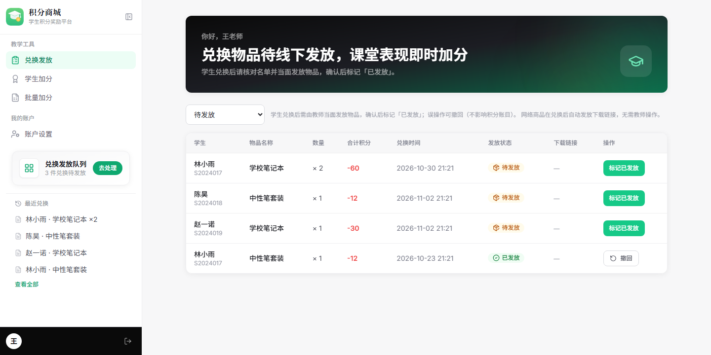
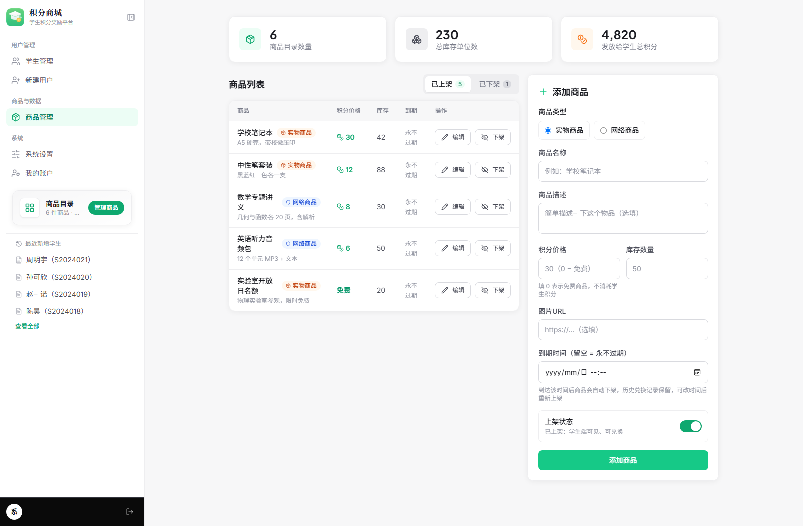
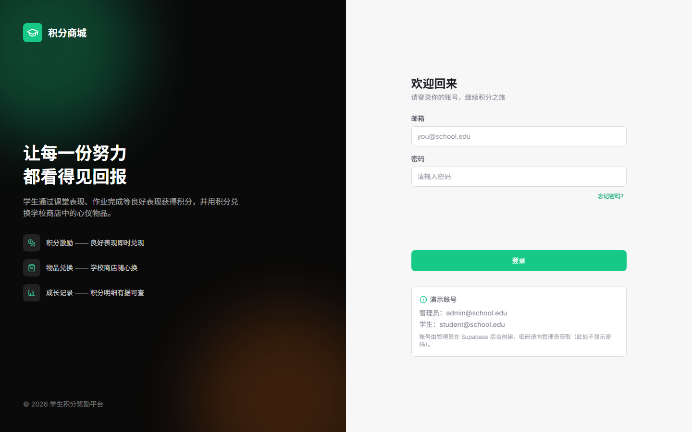

<p align="center">
  
</p>

# 积分商城 Wiki

老师加分、学生兑换、管理员管货 —— 一套可以真正跑在课堂里的校园积分系统。
本 Wiki 是 [README](https://github.com/GB233-grt/class-app#readme) 的展开版，**偏向「照着敲就能跑」**。



---

## 5 分钟上手

```bash
git clone https://github.com/GB233-grt/class-app.git
cd class-app
npm install

cp .env.example .env
cp .dev.vars.example .dev.vars      # 填入 Supabase URL 与 anon key

npm run pages:dev                   # → http://localhost:8788
```

数据库还需要在 Supabase **SQL Editor** 里跑两个文件：

```
database/all-in-one/step1-schema.sql
database/all-in-one/step2-seed.sql
```

完整步骤（含建账号、迁移升级）见 [[快速开始]]。

---

## 页面导航

| 页面 | 什么时候看 |
| --- | --- |
| [[快速开始]] | 第一次部署，从零到能登录 |
| [[配置参考]] | 环境变量填什么、哪些参数可调 |
| [[数据库与迁移]] | 建库、增量升级、跑函数测试、备份 |
| [[部署与运维]] | 发到 Cloudflare、版本升级与回滚 |
| [[常见问题]] | 报错了先来这里搜关键词 |
| [[开发与贡献]] | 改代码、跑测试、提 PR |

---

## 三端截图

| 教师端 · 兑换发放 | 管理端 · 商品管理 |
| --- | --- |
|  |  |

登录页：



> 截图取自真实构建产物，数据为演示用的示例数据。

---

## 关于本 Wiki

- Wiki 是独立于代码仓库的 git 仓库，**每次编辑都有历史记录**，改错了可以随时回看、回滚（见 [[部署与运维#回滚 wiki 页面]]）。
- 页面源文件同时保存在主仓库的 `wiki/` 目录，改完跑 `npm run wiki:publish` 即可同步到 Wiki。
- **不要把任何密钥、数据库密码、真实班级数据写进 Wiki** —— 它是公开的，且历史记录同样公开。
